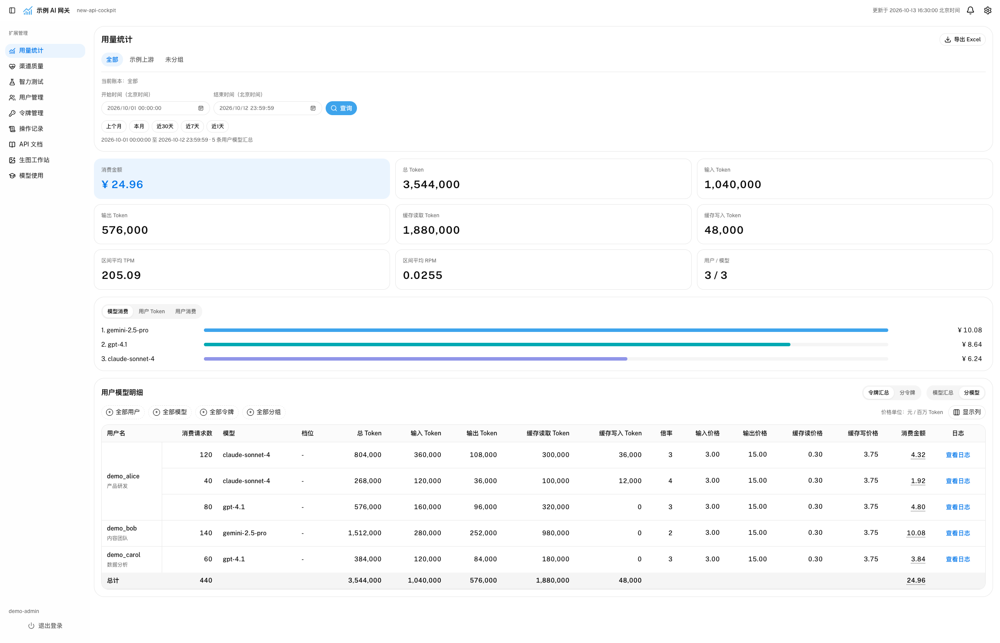
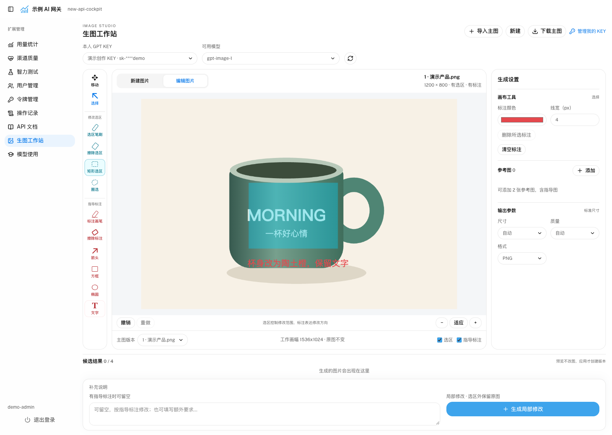

# new-api-cockpit

**New API 的用量统计与扩展管理后台**

[功能](#功能) · [部署](#部署) · [界面预览](#界面预览) · [文档](#文档)

给 [New API](https://github.com/QuantumNous/new-api) 补一套统计和管理页面：查用量、对账、设余额告警，
批量管理用户、令牌和额度，比较渠道质量，也可以测试模型生成动画，或用自己的生图模型 KEY 生成和编辑图片。
页面放在现有站点的 `/cockpit/` 下，登录沿用 New API 账号；管理功能仅对管理员开放，
普通用户也能使用智力测试、模型使用教程和生图工作站；显式启用 AI 助手后，还可用本人 KEY 聊天、整理私有文件和管理自己的 Skill/Memory。
在同站点登录过 New API，可以直接进入。

[VS Code 账户与 KEY 插件](vsix/README.md) 随镜像提供，可从“文档 → 辅助工具”直接下载：使用本人用户 API PAT 查看状态栏余额，在余额下方独立分区申请、复制、删除 KEY 和切换分组；选择 KEY 后可生成 Claude Code / Codex 配置草稿，自行编辑、手动保存才覆盖生效。KEY 按需加载并缓存，手动查询无时间间隔限制，每次修改前后各查一次，不需要另装 MCP 客户端，不调用模型。

本项目需要已部署的 New API，目前支持 PostgreSQL 后端。应用用 Flask 编写，网页与图片请求使用独立容器，
和 New API 共用 Docker 网络，通过同一 HTTPS 入口访问。

## 功能

> AI 助手为当前开发分支功能，默认关闭；已发布镜像的功能以对应 Release 为准。源码变化见[变更记录](CHANGELOG.md)。

页面通过侧边栏切换；“文档”下的模型使用、辅助工具、API 文档为三个平级入口：

| 页面 | 地址 | 可以做什么 |
| --- | --- | --- |
| 用量统计 | `/cockpit/statistics/` | 按用户、模型、令牌和分组筛选，查看 Token、消费排名和价格明细，导出 Excel；从明细跳到相同时间段的 New API 日志 |
| 渠道质量 | `/cockpit/quality/` | 查看性能健康和高频模型，比较渠道成功率、失败码、首字与总耗时分位数、平均输出 token/s 和费用，跳到对应日志 |
| 智力测试 | `/cockpit/intelligence/` | 原版鹈鹕骑车 SVG 测试，流式显示状态和源码，完成后预览；结果仅留在当前页面 |
| 生图工作站 | `/cockpit/image-studio` | 使用本人 KEY 中可用的生图模型创作图片，选区、文字和箭头指导修改，编辑标注并放大比较候选 |
| AI 助手（默认关闭） | `/cockpit/chat/` | 本人 KEY 三协议聊天、附件读取与引用、文档和图片输出、按需联网、完整历史与自适应上下文、自动 Memory |
| 用户管理 | `/cockpit/users/` | 编辑资料、密码、用户组和状态；按组选择用户，预览后批量增减额度；设置每天、每周或每月执行的额度规则 |
| 令牌管理 | `/cockpit/keys/` | 按用户查看 KEY，搜索、查看和复制令牌，修改分组、限额及状态，批量把 KEY 切换到其他分组 |
| 操作记录 | `/cockpit/operations/` | 查看用户、KEY、配额和定时规则的操作，定位目标用户及逐条执行结果 |
| API 文档 | `/cockpit/docs/` | 按流程试调用接口，填写参数、查看响应、复制程序示例，查阅和下载 OpenAPI 描述 |
| 模型使用 | `/cockpit/manual` | 普通用户登录后选择自己的令牌和模型，查看客户端接入教程；页面隐藏完整 KEY，显式复制时才填入 |
| 辅助工具 | `/cockpit/tools` | 从镜像内下载 VS Code 插件，设置账户与 KEY 管理、生成 Claude / Codex 草稿，配置本人账户 MCP |

统计页按渠道标签区分上游账本，也有“全部”和“未分组”。每个账本单独设置预算、报警阈值和监控开关，
共用飞书、钉钉和邮件通知配置，各通知渠道可以独立启停、同时发送。邮件支持 SMTP、STARTTLS、SMTPS，
可使用账号认证或匿名发信，配置方法见[通知渠道](docs/notifications.md)。费用按月、按渠道归档，查看时按渠道当前分组汇总。
每天北京时间 10:00 检查余额，也可以手动检查。

**金额以消费日志为准。** 同一模型按请求发生时的价格和分组倍率分行，匹配当前价格的行显示对应档位。
Token 按消费日志统计，倍率显示请求当时的值。
表格金额显示两位小数，悬浮详情、API 和 Excel 保留原精度。具体见[统计口径](docs/calculation.md)。

用户和 KEY 的修改通过 New API 官方接口执行，每组最多 5 个并发请求。
用户、KEY 和额度的修改需要监控库保存操作记录，只记录已发起的操作。
管理员管理 KEY 时使用所属用户的 PAT，缺失才通过受限函数补建；普通用户的智力测试使用本人登录会话，不创建 PAT。

页面使用的业务接口（聊天模块除外）也可以供脚本调用，统一在 `/cockpit/api/` 下，使用已有 New API 管理员 PAT。
各模块的地址、参数及调用示例见 [API 参考](docs/api.md)。
余额查询为 `/cockpit/api/statistics/balance`，报警检查为 `/cockpit/api/statistics/alert`；后者会按配置发送通知。
登录后从侧边栏打开 API 文档即可在线调试，使用方法见[交互式文档](docs/interactive-api.md)。
请求发往当前站点，修改、通知和付费操作需要确认，不自动重试；图片生成/编辑不开放文档内试运行。

渠道质量默认查看近 24 小时，当前启用渠道的上游在同一列表比较，不跟随余额账本或计费分组筛选；识别重试、流式异常与客户端取消，缺失数据不填成零。
它只读取已有日志，不改变渠道或计费，口径与限制见[渠道质量](docs/quality.md)。

智力测试向所有已登录且启用的用户开放，使用当前用户名下的专用 KEY，没有才创建，按所选模型自动换组。
Anthropic 渠道用 Claude Messages，其他渠道用 OpenAI Chat Completions。
直接等待并显示结果，不保存测试历史；Cockpit 不设置输出 Token 上限，预览会按窗口缩放，也支持调整高度和全屏。
调用正常计费，实际输出仍受 New API 和上游限制，详见[智力测试](docs/intelligence.md)。

模型使用教程覆盖 Claude Code、Codex、WorkBuddy、Hermes、Claude App、Cursor、CC Switch、TRAE、Qoder、Chatbox、OpenClaw 和 curl。
地址取当前站点，按工具分别生成 Chat Completions、Responses 或 Anthropic Messages 配置；
模型在客户端会话中选择，配置不固定默认模型；需要转换协议的 CC Switch 接入会列出本地路由设置。
只查询本人令牌和模型，不改分组或额度，也不发起收费生成，详见[模型使用](docs/manual.md)。
Codex 使用 `config.toml + auth.json` 双文件配置，不再依赖模型 KEY 环境变量。
账户 MCP 的配置步骤和插件说明统一在[辅助工具](docs/tools.md)页面，另见[账户 MCP 协议](docs/mcp.md)：以用户 API 访问令牌（PAT，非模型 KEY）查询本人余额和用量、管理本人 KEY，普通用户和管理员均不能借此操作他人账户。用量查询仅在 MCP 提供，Claude/Codex 配置草稿仅在插件提供。

生图工作站向所有启用用户开放，只用本人已有且分组精确为 `GPT` 的 KEY，管理员也不例外，原始 KEY 不进入浏览器。
每次生成一张，同步等待、不排队，不保存图库或提示词；选区和标注分开，候选需明确采用，局部合成保留选区外原图。
改图有指导标注时，提示词可留空；有选区就做局部修改，只有标注时直接按标注编辑整图。
文字可在画布里直接编辑，标注支持移动、缩放和擦除；候选大图支持缩放、拖动和原图对比。
生成/编辑正常计费，超时或断网不自动重发；认证刷新不重放付费请求，详见[生图工作站](docs/image-studio.md)。

## 部署

默认使用 GitHub Release 的预构建镜像，不在服务器上编译应用：

- **新服务器全量安装**：[发布镜像部署手册](docs/deployment.md)，下载同一 Release 的安装包和镜像，完成建库、账号、Nginx 与登录。
- **已有 New API，只安装 Cockpit**：[已有系统接入](docs/existing-installation.md)，使用对应 Release 的 Compose 和环境示例，不替换现有数据库。
- **开发提交或自行构建**：[源码构建部署](docs/deployment-source.md)，与发布镜像流程分开。
- **维护与回退**：[升级、备份与回退](docs/upgrading.md)。

从 `v0.4.0` 起，Release 提供全量安装包、聊天组件和镜像内 VSIX 下载；`v0.3.0` 不包含这些制品，不能与新版模板混用。可用功能以所选 Release 为准。
New API 与 Cockpit 的浏览器入口须同协议、同主机、同端口，账号共用；应用端口只绑定回环地址，由 Nginx 统一反向代理。

## 界面预览

以下截图取自当前界面，使用离线演示数据，不含真实账号、KEY 或业务记录。

### 用量统计

### 生图工作站

## 文档

- 安装与维护：[部署](docs/deployment.md) · [兼容范围](docs/compatibility.md) · [升级与备份](docs/upgrading.md) · [发版与镜像](docs/releasing.md)
- 统计与告警：[统计口径](docs/calculation.md) · [渠道质量](docs/quality.md) · [余额监控](docs/monitoring.md) · [通知渠道](docs/notifications.md)
- 模型接入与创作：[模型使用教程](docs/manual.md) · [鹈鹕骑车测试](docs/intelligence.md) · [生图工作站](docs/image-studio.md)
- 管理功能：[用户与令牌](docs/users.md) · [手工与定时配额](docs/quota.md) · [登录与会话](docs/authentication.md)
- 程序接入：[交互式文档](docs/interactive-api.md) · [API 参考](docs/api.md)
- 开发：[架构](docs/architecture.md) · [性能机制](docs/performance.md) · [界面规范](docs/ui.md) · [工作站源码维护](docs/image-studio-sources.md) · [贡献指南](CONTRIBUTING.md)
- AI 助手：[使用、隔离与配置](docs/chat.md) · [接口与设计](docs/design/ai-assistant-v2/README.md)（默认关闭，需单独配置聊天请求池）

完整分类见[文档导航](docs/README.md)；最新源码变化见[变更记录](CHANGELOG.md)。公共文档不记录具体服务器的部署状态。

问题和建议请提交到 [Issues](https://github.com/ilove323/new-api-cockpit/issues)，附上版本、复现步骤和脱敏日志。
安全问题见 [SECURITY.md](SECURITY.md)，请勿公开密码、令牌或客户数据。

## 许可证

维护者：[@ilove323](https://github.com/ilove323)。感谢 [QuantumNous/new-api](https://github.com/QuantumNous/new-api)。
本项目为第三方扩展，采用 [Apache-2.0](LICENSE) 许可证，允许商业使用。
New API 和其他依赖各自遵循其许可证；字体与图标归属见 [NOTICE](NOTICE)、
[Lucide 许可](src/new_api_cockpit/static/LUCIDE-LICENSE)、[Public Sans 许可](src/new_api_cockpit/static/fonts/OFL-LICENSE.txt) 和 [Scalar 许可](src/new_api_cockpit/static/SCALAR-LICENSE)。
工作站使用的 GPT Image Playground、InvokeAI 源码版本、许可证与改动见[源码说明](docs/image-studio-sources.md)。
